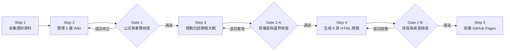

# 📚 FinWiki：個人理財與指數化投資入門（LLM Wiki × 教學 HTML 簡報）

本專案以「先討論、後生成」方式建構 5 篇結構化 LLM Wiki 知識庫，並透過雙重檢查迴圈（Double-Loop Graph）將專業理財知識轉譯為 9 頁零基礎易懂的互動式教學 HTML 簡報。

## 🔗 線上瀏覽連結
- **LLM Wiki 知識庫首頁**：https://usarmena.github.io/investing-wiki/
- **9 頁互動教學 HTML 簡報**：https://usarmena.github.io/investing-wiki/slides.html
- **專案開發規範**：[`AGENTS.md`](./AGENTS.md)

## 🔄 Workflow / Loop Graph 流程圖

